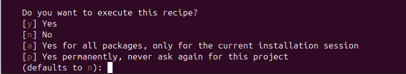
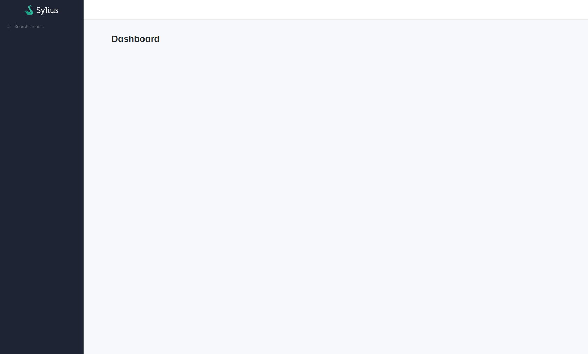

# Getting started

## Setup an admin panel

The Sylius Stack comes with a bunch of components that work great independently, but when they come together, that's when the stack's magic truly operates! 
Indeed, the highlight of this project is the ability to configure an admin panel UI within minutes.

### Create a new project

You can set up the Sylius Stack on existing Symfony projects, but in the case you are starting from scratch, here is what you need to do.

```bash
# With Composer:
composer create-project symfony/skeleton:"8.0.*" my_project_directory
cd my_project_directory
composer require webapp

# Or with Symfony CLI:
symfony new my_project_directory --version="8.0.*" --webapp
cd my_project_directory
````

### Allow Contrib Recipes

Sylius Stack recipes are hosted in the `symfony/recipes-contrib` repository. To ensure Symfony Flex installs them automatically, enable contrib recipes before requiring the packages:

```bash
composer config extra.symfony.allow-contrib true
```

### Install the package using Composer and Symfony Flex

Go to your project directory and run the following command:

```bash
composer require -W \
  doctrine/orm \
  doctrine/doctrine-bundle \
  pagerfanta/doctrine-orm-adapter \
  symfony/asset-mapper \
  sylius/bootstrap-admin-ui \
  sylius/ui-translations
```

<div data-full-width="false">

<figure></figure>

</div>

Type "a" or "p" to configure the packages via Symfony Flex.

Do not forget to set your application secret environment variable:

```dotenv
# ...
APP_SECRET=UseYourOwnSecretPlease
```


### Run your web server

```bash
docker compose up -d
symfony serve -d
```

The admin panel is ready to use.
Now, it's your turn!

<div data-full-width="false">

<figure></figure>

</div>

### Using AssetMapper

By default, the `sylius/bootstrap-admin-ui` package loads prebuilt assets that start their own Stimulus application (the `symfony_ux` hookables).
If your application uses [AssetMapper](https://symfony.com/doc/current/frontend/asset_mapper.html) and starts its own Stimulus application, replace these prebuilt assets with your importmap to avoid running two Stimulus applications (and duplicate Ajax calls), and take control of Stimulus initialization in your own code.

#### Preparing Stimulus for AssetMapper

StimulusBundle needs an `assets/controllers.json` file and an `assets/controllers/` directory.
When the StimulusBundle recipe was applied on a Webpack Encore project, the `assets/controllers/` directory may not exist. In this case, Symfony Flex fails with `The "assets/controllers" directory does not exist` and does not add `@symfony/stimulus-bundle` to your `importmap.php`.

Create the directory if needed:

```bash
mkdir -p assets/controllers
touch assets/controllers/.gitignore
```

Then declare the Symfony UX controllers used by the admin panel, with the same autoimported stylesheets as the prebuilt assets:


```json
{
    "controllers": {
        "@symfony/ux-autocomplete": {
            "autocomplete": {
                "enabled": true,
                "fetch": "eager",
                "autoimport": {
                    "tom-select/dist/css/tom-select.default.css": false,
                    "tom-select/dist/css/tom-select.bootstrap4.css": false,
                    "tom-select/dist/css/tom-select.bootstrap5.css": true
                }
            }
        },
        "@symfony/ux-live-component": {
            "live": {
                "enabled": true,
                "fetch": "eager",
                "autoimport": {
                    "@symfony/ux-live-component/dist/live.min.css": true
                }
            }
        }
    },
    "entrypoints": []
}
```



The Stimulus controllers shipped with the `sylius/bootstrap-admin-ui` package (used by the [copy to clipboard](bootstrap-admin-ui/components/copy-to-clipboard.md) components and the theme switcher of the navbar) are registered automatically: nothing to add for them.


Make sure StimulusBundle and Stimulus are in your `importmap.php`:

```bash
php bin/console importmap:require @symfony/stimulus-bundle @hotwired/stimulus
```

The `@symfony/ux-autocomplete` and `@symfony/ux-live-component` packages also need their importmap entries (such as `tom-select` and the `tom-select/dist/css/*.css` files). Symfony Flex adds them when it installs these packages; if one is missing, add it with `php bin/console importmap:require`.

#### Loading your importmap in the admin panel

Set the importmap entrypoint that starts your Stimulus application:




```yaml
sylius_bootstrap_admin_ui:
    importmap_entrypoint: app
```





```php
use Symfony\Component\DependencyInjection\Loader\Configurator\ContainerConfigurator;

return static function (ContainerConfigurator $containerConfigurator): void {
    $containerConfigurator->extension('sylius_bootstrap_admin_ui', [
        'importmap_entrypoint' => 'app',
    ]);
};
```




The `symfony_ux` hookables of the `sylius_admin.base#stylesheets` and `sylius_admin.base#javascripts` hooks then stop loading the prebuilt Stimulus application and Symfony UX stylesheets, and your importmap is loaded instead.
It is loaded in the `<head>`: the stylesheets imported by your JavaScript (Tom Select, Live Components, your own CSS) are rendered with the page, which avoids a flash of unstyled content.


The option sets the `entrypoint` configuration of both `symfony_ux` hookables. You can also set it per hook with Twig Hooks, as for the `entrypoint` of the Shadcn Admin UI layout:

```yaml
sylius_twig_hooks:
    hooks:
        'sylius_admin.base#stylesheets':
            symfony_ux: { configuration: { entrypoint: 'app' } }
        'sylius_admin.base#javascripts':
            symfony_ux: { configuration: { entrypoint: 'app' } }
```


#### Starting Stimulus App

The StimulusBundle recipe starts the Stimulus application of your importmap entrypoint:


```js
import { startStimulusApp } from '@symfony/stimulus-bundle';

const app = startStimulusApp();
// register any custom, 3rd party controllers here
// app.register('some_controller_name', SomeImportedController);
```



```js
import './stimulus_bootstrap.js';
// ...
```



Older versions of the recipe name this file `assets/bootstrap.js`.


The controllers declared in `assets/controllers.json`, the ones in your `assets/controllers/` directory and the ones of the `sylius/bootstrap-admin-ui` package are registered automatically.
