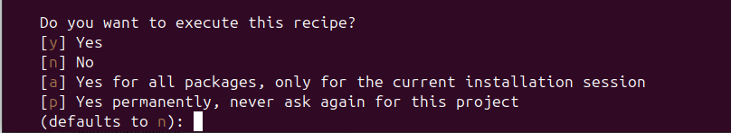
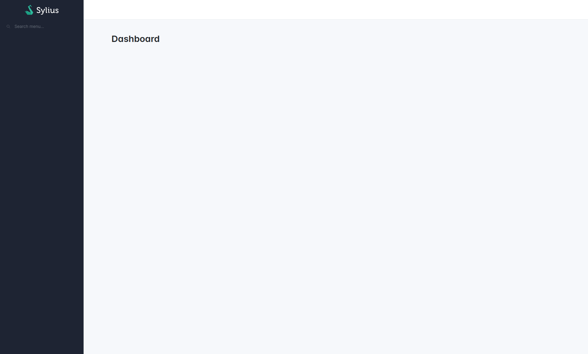

# Getting started

## Setup an admin panel

The Sylius Stack comes with a bunch of components that work great independently, but when they come together, that's when the stack's magic truly operates! 
Indeed, the highlight of this project is the ability to configure an admin panel UI within minutes.

### Create a new project

You can set up the Sylius Stack on existing Symfony projects, but in the case you are starting from scratch, here is what you need to do.

```bash
# With Composer:
composer create-project symfony/skeleton:"8.0.*" my_project_directory
cd my_project_directory
composer require webapp

# Or with Symfony CLI:
symfony new my_project_directory --version="8.0.*" --webapp
cd my_project_directory
````

### Allow Contrib Recipes

Sylius Stack recipes are hosted in the `symfony/recipes-contrib` repository. To ensure Symfony Flex installs them automatically, enable contrib recipes before requiring the packages:

```bash
composer config extra.symfony.allow-contrib true
```

### Install the package using Composer and Symfony Flex

Go to your project directory and run the following command:

```bash
composer require -W \
  doctrine/orm \
  doctrine/doctrine-bundle \
  pagerfanta/doctrine-orm-adapter \
  symfony/asset-mapper \
  sylius/bootstrap-admin-ui \
  sylius/ui-translations
```

<div data-full-width="false">

<figure></figure>

</div>

Type "a" or "p" to configure the packages via Symfony Flex.

Do not forget to set your application secret environment variable:

```dotenv
# ...
APP_SECRET=UseYourOwnSecretPlease
```


### Run your web server

```bash
docker compose up -d
symfony serve -d
```

The admin panel is ready to use.
Now, it's your turn!

<div data-full-width="false">

<figure></figure>

</div>

### Using AssetMapper

By default, the `sylius/bootstrap-admin-ui` package loads prebuilt assets that start their own Stimulus application (the `symfony_ux` hookables).
If your application uses [AssetMapper](https://symfony.com/doc/current/frontend/asset_mapper.html) and starts its own Stimulus application, disable these prebuilt assets to avoid running two Stimulus applications (and duplicate Ajax calls), and take control of Stimulus initialization in your own code.

#### Preparing Stimulus for AssetMapper

StimulusBundle needs an `assets/controllers.json` file and an `assets/controllers/` directory.
When the StimulusBundle recipe was applied on a Webpack Encore project, the `assets/controllers/` directory may not exist. In this case, Symfony Flex fails with `The "assets/controllers" directory does not exist` and does not add `@symfony/stimulus-bundle` to your `importmap.php`.

Create the directory if needed:

```bash
mkdir -p assets/controllers
touch assets/controllers/.gitignore
```

Then declare the Symfony UX controllers used by the admin panel, with the same autoimported stylesheets as the prebuilt assets:


```json
{
    "controllers": {
        "@symfony/ux-autocomplete": {
            "autocomplete": {
                "enabled": true,
                "fetch": "eager",
                "autoimport": {
                    "tom-select/dist/css/tom-select.default.css": false,
                    "tom-select/dist/css/tom-select.bootstrap4.css": false,
                    "tom-select/dist/css/tom-select.bootstrap5.css": true
                }
            }
        },
        "@symfony/ux-live-component": {
            "live": {
                "enabled": true,
                "fetch": "eager",
                "autoimport": {
                    "@symfony/ux-live-component/dist/live.min.css": true
                }
            }
        },
        "@sylius/bootstrap-admin-ui": {
            "copy-to-clipboard": {
                "enabled": true,
                "fetch": "eager"
            },
            "theme-switcher": {
                "enabled": true,
                "fetch": "eager"
            }
        }
    },
    "entrypoints": []
}
```



The `@sylius/bootstrap-admin-ui` entry registers the Stimulus controllers shipped with the package (used by the [copy to clipboard](bootstrap-admin-ui/components/copy-to-clipboard.md) components and the theme switcher of the navbar).
Without it, these components are rendered but do nothing, without any error.


Make sure StimulusBundle and Stimulus are in your `importmap.php`:

```bash
php bin/console importmap:require @symfony/stimulus-bundle @hotwired/stimulus
```

The `@symfony/ux-autocomplete` and `@symfony/ux-live-component` packages also need their importmap entries (such as `tom-select` and the `tom-select/dist/css/*.css` files). Symfony Flex adds them when it installs these packages; if one is missing, add it with `php bin/console importmap:require`.

#### Disabling the prebuilt Stimulus app & Symfony UX stylesheets

Disable the `symfony_ux` hookables of the `sylius/bootstrap-admin-ui` package and add your own hookable that loads your importmap entrypoint.

Load the importmap in the `sylius_admin.base#stylesheets` hook (in the `<head>`) rather than in the `sylius_admin.base#javascripts` one (at the end of the `<body>`):
the stylesheets imported by your JavaScript (Tom Select, Live Components, your own CSS) are then loaded before the page is rendered, which avoids a flash of unstyled content.
Hookables are rendered by descending priority, and the package stylesheets use the default priority (`0`): a negative priority makes sure your stylesheets come after them and can override them.




```yaml
sylius_twig_hooks:
    hooks:
        # ...
        'sylius_admin.base#stylesheets':
            # Disabling Symfony UX stylesheets
            symfony_ux:
                enabled: false
            # New hookable, rendered after the package stylesheets
            app:
                template: 'base/stylesheets/app.html.twig'
                priority: -100

        'sylius_admin.base#javascripts':
            # Disabling Stimulus App
            symfony_ux:
                enabled: false
```





```php
use Symfony\Component\DependencyInjection\Loader\Configurator\ContainerConfigurator;

return static function (ContainerConfigurator $containerConfigurator): void {
    // ...

    $containerConfigurator->extension('sylius_twig_hooks', [
        'hooks' => [
            'sylius_admin.base#stylesheets' => [
                // Disabling Symfony UX stylesheets
                'symfony_ux' => [
                    'enabled' => false,
                ],
                // New hookable, rendered after the package stylesheets
                'app' => [
                    'template' => 'base/stylesheets/app.html.twig',
                    'priority' => -100,
                ],
            ],

            'sylius_admin.base#javascripts' => [
                // Disabling Stimulus App
                'symfony_ux' => [
                    'enabled' => false,
                ],
            ],
        ],
    ]);
};
```





```twig
{{ importmap('app') }}
```


#### Starting Stimulus App

```js
// assets/bootstrap.js
import { startStimulusApp } from '@symfony/stimulus-bundle';

const app = startStimulusApp();
// register any custom, 3rd party controllers here
// app.register('some_controller_name', SomeImportedController);
```

```js
// assets/app.js
import './bootstrap.js';
// ...
```

The controllers declared in `assets/controllers.json` and the ones in your `assets/controllers/` directory are registered automatically.
