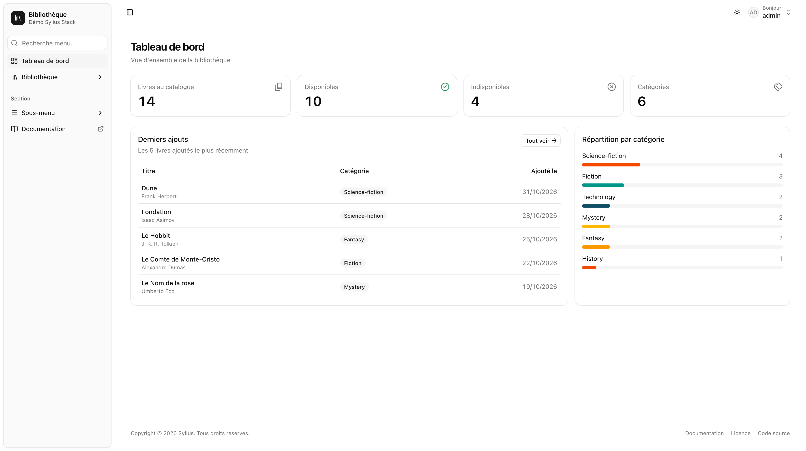
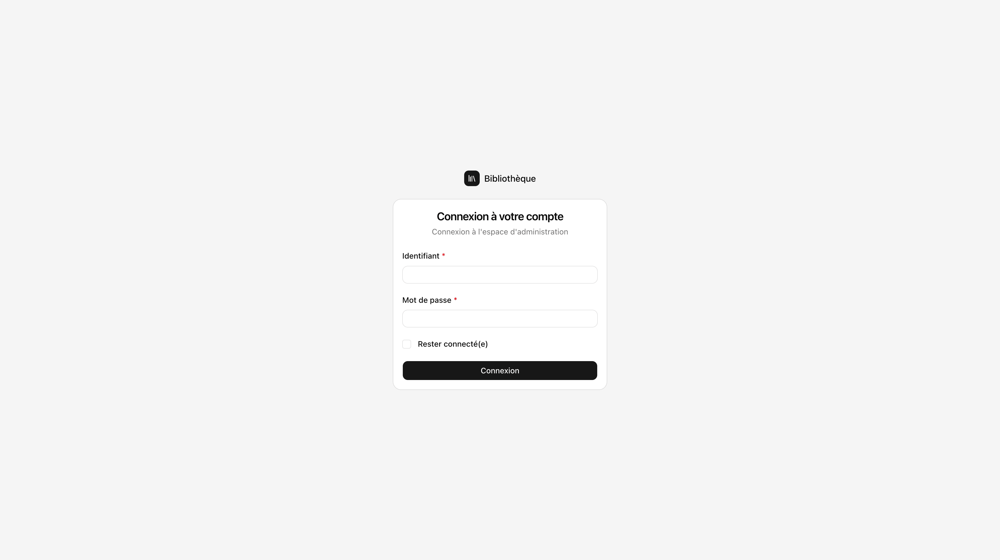
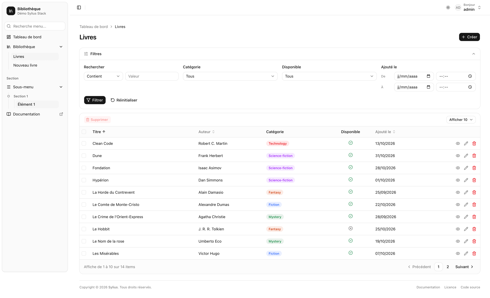
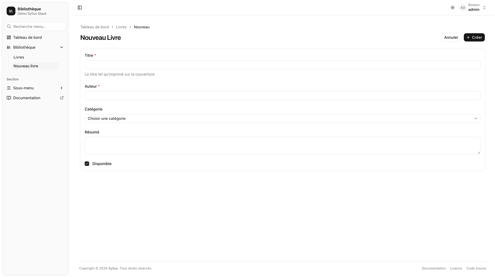

# Getting started

This package is an alternative to [Bootstrap Admin UI](../bootstrap-admin-ui/getting-started.md). It sets up the content of the [AdminUi package](../admin-ui/getting-started.md) templates with Tailwind CSS v4 and shadcn/ui, and keeps the same hooks, hookables and macros.

* **Same hooks and macros:** your `sylius_twig_hooks` customisations keep working, only the template namespace changes.
* **shadcn sidebar:** collapsible to icons, <kbd>Ctrl</kbd>/<kbd>⌘</kbd> + <kbd>B</kbd>, state kept in a cookie, drawer on mobile, 3 variants.
* **Grids:** sorting, filters, pagination, selection and bulk delete, card layout on mobile.
* **shadcn tokens:** paste a theme from [ui.shadcn.com/themes](https://ui.shadcn.com/themes) or [tweakcn](https://tweakcn.com). Dark mode included.
* **AssetMapper only:** no Node and no Webpack, Tailwind runs through `symfonycasts/tailwind-bundle`.



## Requirements

| Package                                                         | Version                            |
|-----------------------------------------------------------------|------------------------------------|
| PHP                                                             | 8.1+                               |
| Symfony                                                         | 6.4, 7.4 or 8.x                    |
| Sylius Stack (`sylius/admin-ui`, `twig-hooks`, `twig-extra`)    | 0.14                               |
| Symfony UX (`ux-twig-component`, `stimulus-bundle`, `ux-icons`) | 2.36+ or 3.5+                      |
| `symfonycasts/tailwind-bundle`                                  | 0.13+ or 1.x, with Tailwind CSS v4 |

Optional packages:

| Package                           | Enables                                     |
|-----------------------------------|---------------------------------------------|
| `pagerfanta/doctrine-orm-adapter` | Grids backed by Doctrine ORM                |
| `symfony/ux-autocomplete`         | Autocomplete fields |
| `symfony/ux-live-component`       | Live Component based forms                  |
| `symfony/workflow`                | The `apply_transition` grid action          |

## 1. Composer


`sylius/bootstrap-admin-ui` can be installed alongside, but never enable both bundles in the same kernel.


```bash
composer require sylius/shadcn-admin-ui
composer require pagerfanta/doctrine-orm-adapter   # if your grids use Doctrine ORM
```

Add the bundle to `config/bundles.php` if Flex did not register it:

```php
Sylius\ShadcnAdminUi\Symfony\SyliusShadcnAdminUiBundle::class => ['all' => true],
```

Then import the theme configuration (hooks, grid templates, anonymous component prefixes), as with
`sylius/bootstrap-admin-ui`:


```yaml
imports:
    - { resource: '@SyliusShadcnAdminUiBundle/config/app.php' }
```



This import is loaded with your own configuration, so hook definitions loaded **after** it override the theme
ones: further down this file, in a `config/packages/` file that comes after it, or in `config/services/`.


The bundle registers on its own:

- the AssetMapper path `@sylius/shadcn-admin-ui`;
- its Stimulus controllers (`shadcn--*` and `admin--*`), next to the ones of `assets/controllers`.

## 2. Stylesheet (Tailwind)

Create `assets/styles/admin.css`:


```css
@import "tailwindcss";
@import "../../vendor/sylius/shadcn-admin-ui/assets/styles/theme.css";

/* Your token overrides */
:root {
    /* --primary: oklch(0.55 0.2 260); */
    /* --radius: 0.5rem; */
}
```


Declare it in `config/packages/symfonycasts_tailwind.yaml`:


```yaml
symfonycasts_tailwind:
    binary_version: 'v4.3.3'
    input_css:
        - '%kernel.project_dir%/assets/styles/app.css'     # your front end, if any
        - '%kernel.project_dir%/assets/styles/admin.css'
```



The theme requires Tailwind CSS v4. Always set `binary_version`: `symfonycasts/tailwind-bundle` 0.13 uses Tailwind CSS 3.4 by default.


Build it:

```bash
php bin/console tailwind:build assets/styles/admin.css --watch   # in dev
php bin/console tailwind:build assets/styles/admin.css --minify  # in prod, before asset-map:compile
```


`theme.css` declares an `@source` on the bundle templates (Tailwind ignores `vendor/` by default). Your own
templates are detected automatically: no extra configuration needed.


Another file name? See [Configuration › Stylesheet and entrypoint paths](configuration.md#stylesheet-and-entrypoint-paths).

## 3. JavaScript entrypoint

`assets/admin.js`:


```js
import './stimulus_bootstrap.js';
```


`importmap.php`:


```php
'admin' => ['path' => './assets/admin.js', 'entrypoint' => true],
```


## 4. Icons

The theme uses `lucide:*` icons through Symfony UX Icons.


In production, lock them locally, otherwise they are fetched from the Iconify API at runtime:

```bash
php bin/console ux:icons:lock
```


## Optional: Symfony UX Autocomplete

`theme.css` draws Tom Select fields as a shadcn combobox and **fully replaces** the Tom Select stylesheet.


Disable the automatic import of the Tom Select stylesheet in `assets/controllers.json`: it is not in a CSS layer,
so it would win over the theme.


```json
"@symfony/ux-autocomplete": {
    "autocomplete": {
        "autoimport": {
            "tom-select/dist/css/tom-select.default.css": false,
            "tom-select/dist/css/tom-select.bootstrap4.css": false,
            "tom-select/dist/css/tom-select.bootstrap5.css": false
        }
    }
}
```

## Checklist

- [ ] `sylius/shadcn-admin-ui` installed, and only one of the two bundles enabled in the kernel
- [ ] `@SyliusShadcnAdminUiBundle/config/app.php` imported
- [ ] `assets/styles/admin.css` created and listed in `symfonycasts_tailwind.input_css`
- [ ] `admin` entrypoint declared in `importmap.php`
- [ ] `tailwind:build --watch` running in dev
- [ ] `ux:icons:lock` run before deploying
- [ ] Tom Select stylesheets disabled (only with UX Autocomplete)

## Screenshots






