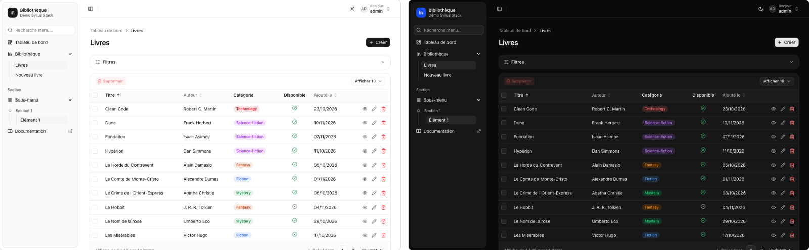
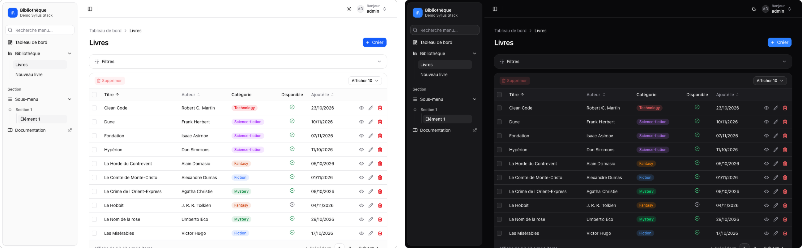
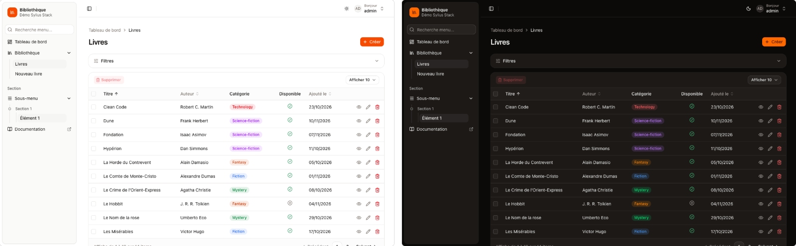
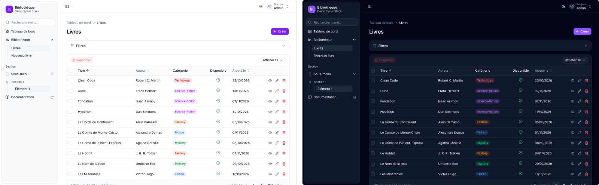
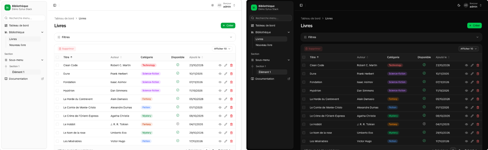
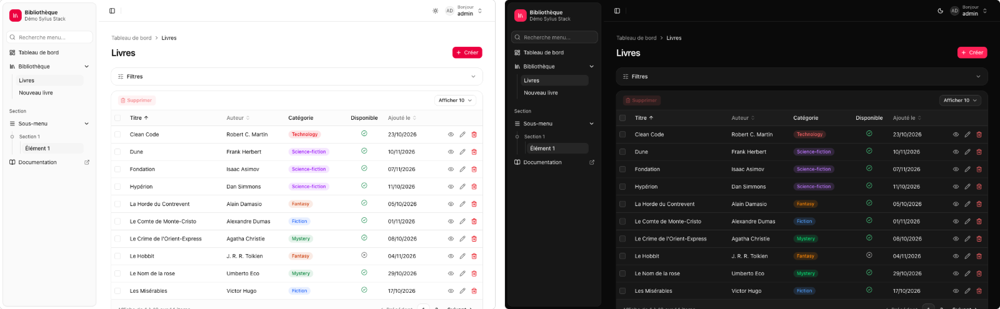

# Theming

## Color themes

The bundle ships interchangeable color themes in `assets/styles/themes/`. They are plain CSS files (tokens only), so
switching from one to another needs no Tailwind rebuild.

| Kind       | Themes                                       | Changes                                                    |
|------------|----------------------------------------------|------------------------------------------------------------|
| Base color | `stone`, `zinc`, `slate`                     | The grays: backgrounds, borders, texts                     |
| Accent     | `blue`, `green`, `orange`, `rose`, `violet`  | Primary actions, focus rings, active sidebar items         |

Without any theme, the panel uses the neutral grays and a black/white primary.

Enable them in the bundle configuration, a base color first, then an accent:


```yaml
sylius_shadcn_admin_ui:
    themes: [zinc, blue]
```


The themes are loaded in this order, before your Tailwind entry: your own token overrides in `admin.css` still win.

Light and dark modes of a few combinations:

**No theme (neutral)**



**`[zinc, blue]`**



**`[stone, orange]`**



**`[slate, violet]`**



**`[green]`**



**`[rose]`**



Your own theme can be listed too, as the asset path of a CSS file defining the tokens for `:root` and `.dark`:

```yaml
sylius_shadcn_admin_ui:
    themes: [slate, 'styles/themes/brand.css']
```


Prefer a single stylesheet? Import a theme in your Tailwind entry instead, after `theme.css`:
`@import "../../vendor/sylius/shadcn-admin-ui/assets/styles/themes/blue.css";`


## Design tokens

Every token follows the shadcn naming: `--background`, `--foreground`, `--primary`, `--sidebar`, `--radius`…


A theme generated on [ui.shadcn.com/themes](https://ui.shadcn.com/themes) or [tweakcn.com](https://tweakcn.com) can
be pasted **as is** into your `admin.css`, after the `theme.css` import.



```css
@import "tailwindcss";
@import "../../vendor/sylius/shadcn-admin-ui/assets/styles/theme.css";

:root {
    --primary: oklch(0.55 0.2 260);
    --primary-foreground: oklch(0.98 0 0);
}

.dark {
    --primary: oklch(0.7 0.15 260);
}
```


Tokens added on top of shadcn:

| Token        | Usage                                  |
|--------------|----------------------------------------|
| `--success`  | Positive states, success flashes       |
| `--warning`  | Warnings                               |
| `--info`     | Informational messages                 |

## Radius and font

`--radius` (default `0.625rem`) drives the whole scale: `--radius-sm` to `--radius-4xl` are computed from it.

```css
:root {
    --radius: 0.5rem;
}

@theme {
    --font-sans: "Inter", ui-sans-serif, system-ui, sans-serif;
}
```

## Tone palette

Twelve hues for statuses and categories, each with a light and a `.dark` value:

| Token          | Token          | Token          | Token          |
|----------------|----------------|----------------|----------------|
| `--tone-blue`  | `--tone-azure` | `--tone-indigo`| `--tone-purple`|
| `--tone-pink`  | `--tone-red`   | `--tone-orange`| `--tone-yellow`|
| `--tone-lime`  | `--tone-green` | `--tone-teal`  | `--tone-cyan`  |

They are exposed as Tailwind utilities: `bg-tone-blue`, `text-tone-green`, `border-tone-red/30`…

## The `tone()` macro

`tone(color, kind)` of `@SyliusShadcnAdminUi/shared/helper/palette.html.twig` turns a color name into classes.
Use it instead of building classes by concatenation (`"bg-" ~ color` is invisible to Tailwind and would not be
generated).

```twig


<span class="rounded px-2 {{ tone(order.state.color, 'soft') }}">{{ order.state|trans }}</span>
```

| `kind`   | Renders                                                       |
|----------|---------------------------------------------------------------|
| `soft`   | Tinted background + colored text (default)                    |
| `solid`  | Filled background + contrasting text                          |
| `text`   | Colored text only                                             |
| `dot`    | Filled background, for status dots                            |
| `hover`  | Filled on hover / focus of a `group/tile` parent              |
| `alert`  | Tinted background + border + colored text, for alerts         |

**Accepted colors**

| Kind     | Values                                                                                   |
|----------|------------------------------------------------------------------------------------------|
| Tones    | `blue`, `azure`, `indigo`, `purple`, `pink`, `red`, `orange`, `yellow`, `lime`, `green`, `teal`, `cyan` |
| Semantic | `success`, `danger`, `warning`, `info`, `primary`, `secondary`, `dark`, `brown`          |
| Aliases  | `muted`, `gray`, `grey` → `secondary` · `body`, `black` → `dark`                         |


An unknown color renders as `secondary`: a typo never breaks the page.


The same palette powers the [`badge` and `dot` components](components.md#sylius-components).

## Dark mode

The navbar has a light / dark switch (`admin--theme-switcher` controller). It toggles the `dark` class on
`<html>` and stores the choice in `localStorage` (`sylius-theme` key). The initial theme is applied by an inline
script before the stylesheet loads, so there is no flash of the wrong theme.

Override dark values in a `.dark { … }` block, as in the [example above](#design-tokens).
